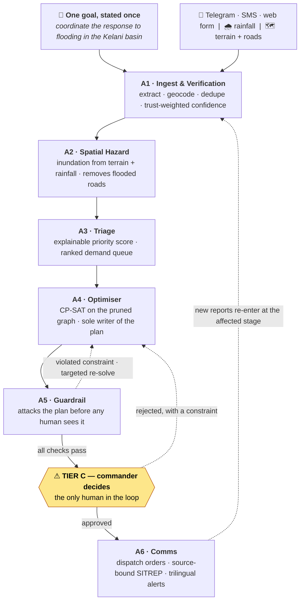

# ResQ-Mesh

**An autonomous situational intelligence and resource dispatch engine for flood and landslide response.**

Team **Teal Titans** — University of Moratuwa
Ashfak Nawshad · Shakil Ilham · Shazan Faslan
CodeSplash'26 Agentic AI Phase — Theme 03, AI Disaster Response Coordinator

---

## The problem

During a flood, response teams do not lack information. They drown in it. Reports arrive by
phone, SMS, social media and radio, in Sinhala, Tamil and English. The same collapsed culvert is
logged four times while a genuinely separate emergency two kilometres away is missed. One caller
says a road is passable; twenty minutes later another says it is gone. Dispatchers plan against a
static road map while the water moves. Because prioritisation, routing and communication all pass
through the same few people, the response is slowest exactly when the event is largest.

Sri Lanka's Disaster Management Centre issues early warnings and situation reports. What is
missing is the **tactical layer** between a national warning and an individual rescue: which of
forty simultaneous calls to answer first, which of six vehicles to send, and which road will still
exist when it arrives.

ResQ-Mesh is that layer. A commander states one goal — *"coordinate the response to flooding in
the Kelani basin"* — and the system perceives, reasons, decides and re-plans on its own, stopping
only to ask a human before it commits people to danger.

## What it does



Every arrow above is chosen by **A0, the Incident Supervisor**, which decides what runs next from
the state, holds the re-plan triggers, and is the only component that may declare an incident
resolved.


1. **Perceive.** Reports become typed incidents: hazard, place, headcount, vulnerability. Place
   names resolve against a gazetteer of Grama Niladhari divisions. Duplicates merge. A report that
   cannot be located is **held**, never guessed at.
2. **Model the hazard.** Rainfall plus terrain gives an inundation estimate; flooded road segments
   are **removed from the routing graph**, so a plan that drives a crew into rising water is not
   discouraged, it is unrepresentable.
3. **Triage.** Each cluster scores on hazard, exposure, vulnerability, time-criticality and
   confidence. Every score decomposes into the evidence and weights that produced it.
4. **Plan.** A constraint solver assigns vehicles to incidents on the pruned graph under a hard
   time budget, reporting its optimality gap honestly.
5. **Verify.** A critic agent attacks the plan: no route through a no-go zone, no capacity
   exceeded, no invented place, no dispatch on evidence below the confidence floor.
6. **Ask.** Only now is a human involved, and only for the irreversible act.
7. **Act and adapt.** Dispatch orders, a source-bound SITREP and trilingual alerts go out; new
   reports re-enter the loop **at the affected stage**, not from the beginning.

### Autonomy: a contract, not a claim

Every action the system can take is classified in advance.

| Tier | Meaning | Examples |
|---|---|---|
| **A** | Fully autonomous, reversible, no human in the path | ingest, dedupe, recompute hazard, re-rank, re-solve |
| **B** | Autonomous, commander notified | raise an area's risk class, publish a SITREP |
| **C** | **Human approval mandatory** — irreversible | dispatch a crew, public evacuation order |

The supervisor decides everything up to the gate. A model may reorder *reversible* work, but halt,
escalation, the gate and release are decided by rule alone: the model cannot move the system
closer to a physical act. In the bundled demo, **14 autonomous steps** run between the goal and
the first human decision.

---

## Quick start

Nothing below needs an API key, a download, or a network connection.

**Requirements:** the `jac` toolchain (one self-contained binary, which brings its own runtime):

```bash
curl -fsSL https://raw.githubusercontent.com/jaseci-labs/jaseci/main/scripts/install.sh | bash
jac install                                   # numerical libraries and the console's packages
jac run --no-takeover scripts/demo.jac        # a whole incident, offline, in under a minute
```

That replays a synthetic Kelani incident: eleven reports arrive, the loop runs unattended to the
approval gate, a commander approves, a second wave arrives mid-incident and forces a re-plan, and
a rejection re-solves under the commander's constraint. It prints the trace the agents wrote
while deciding. Add `--interactive` to make the decisions yourself.

### The full system: server + console

```bash
RESQMESH_DEMO=1 RESQMESH_LLM=offline jac run --no-dev main.jac     # http://localhost:8000
```

The server builds its world on its first scheduler tick, so the first minute answers *starting*;
the console waits for it. `jac run --dev main.jac` serves the console with hot reload instead.
The console is at `/console` and always talks to the live server; there is no demo mode and no
bundled snapshot, so nothing on screen is ever anything other than the running system. The
endpoints are typed functions served at `/function/<name>`, with interactive documentation at
`/docs`.

`RESQMESH_AUTH_MODE` decides what the sign-in screen offers. Left blank it is `static` whenever
`RESQMESH_COMMANDER_TOKEN` is set: shared tokens, no accounts, so the console asks for the token
rather than a username. Set it to `accounts` to get real logins, attributed approvals and the
first-commander setup below. **A deployment wanting named commanders must set it explicitly**: a
token in the environment is not on its own a request for accounts. With neither, the server is
`open` and the console signs in by itself, which is for local development only.

To run it authenticated, start in accounts mode and let the console create the first commander:

```bash
RESQMESH_AUTH_MODE=accounts RESQMESH_DEMO=1 jac run --no-dev main.jac
```

The server prints a one-time **setup code**; open `/console` and it offers a first-commander form
instead of a login. The door closes as soon as that account exists.
`jac run --no-takeover scripts/accounts.jac bootstrap <name> --code <code>` does the same thing from a
terminal, and `add`, `list` and `enrol` manage the rest of the roster on a running server.
Set `JAC_SERVE_AUTH_SECRET` to a long random value before exposing an instance: it signs session
tokens, and the built-in default is public. Sessions last a day.

### Crisis-focused commander console

The console keeps operational counts and pending decisions visible above the workspace.
Wide screens show the incident queue, map and decision panel together; phones use larger
view controls. A pending decision never switches away from the operator's current view.
The map starts in 2D, with 3D available on demand.

Reported people are the largest reported headcount per open, ranked cluster, matching
triage rather than adding duplicate reports. A `+` means some incident headcounts are
unknown. Completed clusters are excluded. Available vehicles must be marked available
in the roster and have no released, en-route or on-scene commitment.

Server contact time is separate from the incident's last change. A failed poll or more
than 15 seconds without a response marks the picture stale and disables plan decisions;
the last picture stays visible, polling retries, and the emergency halt stays accessible.
Requests time out after 15 seconds so a stalled connection can be retried.

Use the toolchain pinned in `jac.toml` (0.37.25); the older Windows PyPI compiler cannot
compile this app's current client syntax. Validate the overview with
`jac test tests/crisis_tests.jac` and compile the console with
`jac build -a client main.jac`.

### With real language models

Copy `.env.example` to `.env` and add at least one key. Providers without a key are skipped.

```bash
RESQMESH_LLM_ORDER=gemini,groq,deepseek
GEMINI_API_KEY=...     # free tier, no card: https://aistudio.google.com/apikey — also reads photos
GROQ_API_KEY=...       # free tier, text only
DEEPSEEK_API_KEY=...   # optional, paid
```

```bash
jac run --no-takeover scripts/demo.jac --llm live
RESQMESH_DEMO=1 jac run --no-dev main.jac           # the live chain is the default
```

### Field reports over Telegram

Create a bot with [@BotFather](https://t.me/BotFather), put `TELEGRAM_BOT_TOKEN=...` in `.env`, and
start the server. It long-polls for messages, so **no public URL is needed**. Message the bot and
the report enters the loop within seconds; it replies with a reference. `/start` gives instructions
in all three languages. (A webhook endpoint exists for deployments with a public HTTPS URL: set
`TELEGRAM_WEBHOOK_SECRET` and point Telegram's `setWebhook` at `/telegram/webhook/<secret>`.)

### The real Kelani basin (~250 MB download)

```bash
jac run --no-takeover scripts/fetch_data.jac                    # SRTM terrain, OSM roads, 757 GN divisions, rainfall archive
jac run --no-takeover scripts/demo.jac --world real             # the real basin, May 2016 rainfall replayed
RESQMESH_DEMO=1 RESQMESH_WORLD=real jac run --no-dev main.jac   # same, behind the server and console
```

This is the real thing: 757 Grama Niladhari divisions with their Sinhala names, the OpenStreetMap
drivable network (45,498 nodes), and SRTM terrain. The first run computes and caches the HAND
surface (~15 s); later runs reuse it.

**Which day you replay changes the result, so both are stated.** The default clock is
14 May 2016, two days before the disaster peaked: 96 mm/24 h, **4,953 road segments** cut,
**35 divisions** no-go. That is the configuration to demonstrate, because the fleet can still
move and you can watch the optimiser route around the water — in the bundled scenario it sends a
boat 16 km via the Colombo–Katunayake Expressway viaduct because every nearer crossing is cut.

The peak itself is 15 May 2016, and the Open-Meteo archive puts 262 mm in that 24 hours:

```bash
RESQMESH_DEMO=1 RESQMESH_WORLD=real RESQMESH_AT=2016-05-16T00:00 jac run --no-dev main.jac   # the peak
```

At that rainfall the HAND model cuts **11,406 road segments** and marks **87 divisions** as no-go —
and then *nothing can be dispatched at all*: A4 reports `no route out of depot` for all five
vehicles, because the pruned network no longer connects a single depot to a single incident. We
are reporting that rather than hiding it. Part of it is real (the basin genuinely was impassable in
places in 2016), and part of it is a limit of our model, which is recorded in *Known limitations*.

Without the download everything still works on a synthetic grid (the default world), which is what
CI runs.

---

## Running with Docker

> **Prerequisites:** [Docker Desktop](https://www.docker.com/products/docker-desktop/) (or Docker Engine + Compose v2). No toolchain or API keys required.

```bash
git clone <repository-url>
cd resqmesh
docker compose up --build
```

Once the container is healthy (the first start takes a minute or two while the world builds), open
**http://localhost:8000**. You land on the public **landing page** — from there, *Commander console*
(`/console`) shows the live incident (demo mode opens a synthetic Kelani incident, so there is a
running system to watch), *Report an emergency* (`/report`) files a report, and *Emergency bulletins*
(`/news`) reads the public alerts.

Copy `.env.example` to `.env` before `docker compose up` if you want live language-model extraction.
Without any keys, the system falls back to a deterministic rule-based extractor — the full pipeline
still works. The `env_file` in `docker-compose.yml` is marked `required: false`, so the container
starts with or without a `.env` file.

| Volume | Contents |
|---|---|
| `resqmesh-state` | The graph store: the incident, the roster and the learned source trust |
| `resqmesh-outputs` | SITREP PDFs, `metrics.json` from the evaluation harness |
| `resqmesh-data` | Downloaded terrain and road graph (if `fetch_data.jac` is run) |

```bash
docker compose down          # stop and remove containers (volumes kept)
docker compose down -v       # also remove volumes (wipes the incident and SITREPs)
```

### Deploying on Coolify

Create a **Public Repository** resource, pick the **Dockerfile** build pack, branch `main`, and set
**Ports Exposes** to `8000`. Then:

- **Environment variables** (Production): `RESQMESH_AUTH_MODE=accounts`, `RESQMESH_SETUP_CODE=<a long
  random code>`, `JAC_SERVE_AUTH_SECRET=<a long random value>`, `RESQMESH_SALT=<a long random value>`,
  `RESQMESH_PUBLIC_HOST=<your domain>`, plus any of `GEMINI_API_KEY`, `GROQ_API_KEY`,
  `TELEGRAM_BOT_TOKEN`. Add `RESQMESH_DEMO=1` to start with the synthetic incident open.
- **Persistent storage:** mount `/app/outputs` (SITREP PDFs and routing graphs) and `/app/data` (the
  real basin data). Mount `/var/lib/resqmesh/jac` too: it holds the unpacked runtime and, without
  `JAC_DB_URL`, the embedded database.
- **Database:** add a **PostgreSQL** database resource in the same Coolify project and environment,
  copy its internal URL, and set `JAC_DB_URL` on the app to that URL, with the scheme written as
  `postgresql://`. Without it the app keeps an embedded database inside the
  `/var/lib/resqmesh/jac` volume, and a rolling update (which Coolify does whenever its health check
  is on) starts the new container while the old one still has that database open, which corrupts
  it. With an external database the two containers simply share one server.
- **Health check:** with `JAC_DB_URL` set, path `/healthz`, port `8000`, start period 120 s. Without
  it, leave Coolify's health check off so the old container stops before the new one starts.
- **Secrets:** untick **Build Variable** on every environment variable, so keys and tokens are not
  passed as build arguments and printed in the build log.
- **Memory:** the build needs about 3 GB free (it seals the app with `jac build`); the running container
  needs about 1 GB.

Open `/console` after the first deploy and enter the setup code to create the first commander.

**The real Kelani basin.** The image starts on the synthetic world. For the real one, set
`RESQMESH_WORLD=real` (and optionally `RESQMESH_AT`), mount `/app/data` as a persistent volume, and
run this once from the container's terminal in Coolify:

```bash
sh /app/scripts/get_data.sh
```

By default it builds the data from the public sources (about 250 MB of downloads, and the road
network is memory-hungry, so keep spare memory free while it runs). To skip that, host a prepared
bundle (a `.tar.gz` whose paths start with `data/`) and set `RESQMESH_DATA_URL` to it: the script then
just downloads and unpacks it. Restart the application afterwards; the first start with the real
world also derives the flood-depth raster once, slowly, and caches it in `/app/data/cache`.

---

## Who uses which page

One process serves every role from the same origin, so nothing extra is deployed. Only the two
public pages (`/` and `/report`, plus reading `/news`) need no account; everything that reveals the
tactical picture or commits a resource is behind a session.

| Role | URL | What they do |
|---|---|---|
| **Anyone** | `/` | Public landing — report an emergency or read the bulletins; links on to the responder and commander views. A visitor never lands on the console. |
| **Citizen / caller** | `/report` | Reports an emergency in Sinhala, Tamil or English. **No account.** The form offers the device's own GPS fix (with a map-pin fallback), so the report carries a real location, not a division centroid. It then enters the loop, geocoded and deduped exactly like a Telegram or radio report. |
| **Public** | `/news` | Reads the approved bulletins, newest first, timestamped, **one language at a time** with a shareable `?lang=si\|ta\|en` link. A bulletin can expire or be stood down, so the feed reflects what is *currently* in force, not a growing pile. Read-only, no account. |
| **Commander / dispatcher** | `/console` | Signs in, then reviews the ranked queue, works the Tier C approval gate, halts, and sees the full record (audit trail, SITREPs, published bulletins, held reports, fleet). Approving a dispatch and publishing a public bulletin are **two separate decisions**. |
| **Vehicle operator** | `/responder` | A crew (an army boat, a truck) enrols once, then sees its live dispatch — where to go, how many people, ETA, exact coordinates and a **Navigate** link. It reports back **en route / on scene / complete**, or **declines** with a reason (which becomes a solver constraint — e.g. a bridge is out). *Complete* closes that emergency and frees the crew. Call sign only (`BOAT-01`); no personal names. |

**Authorisation, and how the order reaches a crew.** `RESQMESH_AUTH_MODE=accounts` authenticates
commanders and dispatchers against password accounts, so every approval records *who* gave it from
the session — not a name typed into a form. The first commander is created from a one-time setup
code the server prints at startup (or `scripts/accounts.jac bootstrap`). A vehicle is enrolled by a
**single-use link** the command post issues — `/responder?c=<code>` — which, opened once, exchanges
the code for a device session bound to that call sign; the code is then dead, sessions expire, and a
lost phone is revoked from the console. (This replaces the earlier `?k=<viewer-token>` link, where
the URL *was* the credential and kept working wherever it was forwarded.) Delivery is pull, not
push — the page polls, so a dropped signal costs nothing and on reconnect the current order is
simply there; when an order first arrives the page raises a browser notification so an idle phone
buzzes. Before approval the card reads *awaiting commander approval — do not move yet*; on approval
it flips to *DISPATCHED*.

For a single-operator demo, `static` mode (a shared `RESQMESH_COMMANDER_TOKEN`) skips accounts and
the console just asks for the token; with no token at all the API runs open, which is what the
bundled Docker demo does. Field reporters can also message the **Telegram bot** (see below);
operators without the `/responder` page still receive tasking by radio from the command post, which
is how a zero-connectivity dispatch reaches a vehicle regardless.

### Running live, with no seeded data

`RESQMESH_DEMO=1` opens a synthetic incident so evaluators see a running system instantly. To instead drive
the whole thing yourself — the real end-to-end test — start empty:

```bash
RESQMESH_DEMO="" docker compose up --build          # macOS / Linux
```
```powershell
$env:RESQMESH_DEMO=""; docker compose up --build     # Windows PowerShell
```

Then, as each role:

1. **Commander** — open `/console`. In the bundled Docker demo the API is open, so it goes straight
   in; a secured deployment signs in first (accounts) or asks for the shared token (static). With no
   incident the console shows **Open incident**; state the goal and open it.
2. **Citizen** — open `/report` (on any device) and submit what you see, in Sinhala, Tamil or
   English. Allow location if prompted, or drop the map pin.
3. **Commander** — the plan appears at the Tier C gate; approve, modify or reject it. Publishing a
   public bulletin is a separate tick on the approval.
4. **Responder** — enrol a device from the console's Fleet panel, open the `/responder?c=<code>`
   link it gives you, and the card flips to **DISPATCHED** the moment the plan is approved. Report
   *complete* to free the crew, or *decline* to send a constraint back to the optimiser.

**One report will not dispatch a crew, by design.** A single uncorroborated source scores 0.40,
below the 0.50 dispatch floor, and the same person reporting twice is still one vote. To cross the
floor, a place needs **two independent reporters** — so put a different name or phone in the report
form's optional field. This is the safety rule, not a bug: it is what stops one prank call from
sending a boat.

---

## Technology stack

| Layer | Choice | Why |
|---|---|---|
| Language and runtime | **Jac** | One language for the agents, the graph, the server endpoints and the console. The incident is a node in a persistent graph and the agents are stations on it, so every transition is stored and the audit trail and replay come with the model. |
| State & contracts | **Typed `obj` contracts with validated construction** | Agents share one strongly typed state with exactly one writer per field, so a whole class of coordination bug is impossible rather than merely avoided. |
| Language + vision | **Gemini Flash → Groq → DeepSeek → rules** | Free tiers first, automatic failover, and a deterministic offline tier so extraction degrades instead of stopping. One OpenAI-compatible HTTP adapter serves all of them, so adding a provider is configuration, not code. |
| Optimisation | **Google OR-Tools CP-SAT** | Vehicle assignment under capacity, priority and reachability is combinatorial; a solver with anytime behaviour returns its best plan *and* its optimality gap under a hard time budget. |
| Geospatial | **SRTM + OSMnx, NetworkX, Shapely, rasterio** | HAND inundation from real terrain; the road graph the optimiser routes on is the same graph the hazard model prunes. |
| Persistence | **Jac's graph store** | Zero administration, durable, and an incident survives a restart. Incident volume is far below anything needing a cluster. |
| Server | **Jac endpoints and scheduled tasks** | One process serves the typed endpoints, the Telegram channel and the built console, which fits a single public port. A single scheduled writer executes every command in order. |
| Console | **Jac client, Mantine, Leaflet, MapLibre** | The console imports the server's endpoints as typed functions, so a contract change breaks the build rather than the demo. |
| Cost | **US$ 0.00 recurring** | Every component is open source or a permanent free tier. No GPU anywhere. |

---

## Safety and responsible AI

- **The language model never computes a number that matters.** It extracts structure from text,
  reads photographs and drafts prose. Distances, ETAs, priority scores, inundation extents and
  vehicle assignments all come from deterministic code that the guardrail agent independently
  re-checks. This is what makes an adversarial critic possible at all.
- **Two hard constraints, not targets.** A dispatch to a place that does not resolve to a real
  division, or a single unsourced sentence in a situation report, fails the safety layer
  regardless of every other number.
- **A single uncorroborated report cannot commit a crew.** One unknown source scores 0.40, below
  the 0.50 dispatch floor. A second independent source clears it.
- **Disagreement is modelled, not averaged.** Where evidence genuinely balances, the cluster is
  marked *unresolved* and its confidence drops rather than a winner being forced. Repetition is
  not corroboration: the same person reporting four times is one vote.
- **Fairness.** Vulnerability scoring uses functional need only — mobility, medical dependency,
  age, children, household size. Ethnicity, religion, language and proxies for them are excluded
  at the schema boundary, and a test enforces it.
- **Privacy.** Phone numbers, emails and NIC numbers are stripped before any text reaches a hosted
  model. Reporter identities are stored only as salted HMAC pseudonyms; the raw identifier is
  never persisted. A test asserts no phone number appears anywhere in the API's output.
- **Accountability.** Every state transition is checkpointed, every approval records who approved
  which exact plan version and when, and situation reports are hash-chained so silent revision is
  detectable.
- **Emergency halt.** One control freezes all autonomous execution while preserving the incident
  picture.

---

## Evaluation

```bash
jac run --no-takeover scripts/run_replay.jac     # runs a scenario and writes outputs/metrics.json
```

A scenario is replayed through the real seven-agent graph and scored against labels. The harness
recomputes the hard constraints itself rather than trusting the guardrail agent's own verdict, and
**any metric with nothing to measure is reported as `not measured`, never as a free pass.**

### One number measured against ground truth we did not write

```bash
jac run --no-takeover scripts/fetch_data.jac --only flood_reference   # 45 KB
jac run --no-takeover scripts/validate_hazard.jac
```

Everything in `outputs/metrics.json` is scored against labels written alongside the scenario, so it
is a regression check. This is the exception. The hazard footprint is scored against the **WFP ADAM
rapid impact analysis for the Cyclone Ditwah floods** (NOAA VIIRS five-day composite at 375 m,
1 December 2025, CC BY-SA on HDX) — an independently published flood extent over the same basin.
The model is given nothing but the date: it pulls the rainfall that actually fell from the
Open-Meteo archive, computes its own HAND surface, and the two footprints are compared at
divisional secretariat granularity, which is the unit alerts and dispatch actually work in.

| | |
|---|---|
| Divisions the reference puts under water | 177 of 757 |
| Divisions we flagged | 365 |
| **Recall** — really-flooded divisions we warned about | **0.938** (166 of 177, 11 missed) |
| **Precision** | **0.455** (199 false alarms) |
| **Division IoU** | **0.442**, against a 0.60 target |
| Cloud obscuring the basin | 0% — nothing had to be excluded |
| Control: same code on a quiet day (20 Feb 2026) | **0 divisions flagged** |

Read it as: the model finds nearly every flooded division and over-warns by about a factor of two.
For evacuation that is the safer direction of error, but it is a real cost in wasted vehicles, and
the IoU target is missed. The control matters as much as the result — a model that flagged the whole
basin would score perfect recall against any flood, so the same code was run on a dry day and must
come out empty. It does. Two caveats that cut in opposite directions: a 375 m optical composite
cannot see small urban floods, so some of those 199 "false alarms" are likely real water the
satellite missed, which makes 0.455 a lower bound; and one event is one event, not a validated model.

**What today's other numbers mean.** The scenario that runs in CI is **synthetic and self-labelled**. Its
scorecard is marked `reference: synthetic self-consistency (regression check, not an accuracy
claim)`, and it should be read that way: it proves the pipeline works end to end and catches
regressions. It is **not** evidence of hazard or triage accuracy, because the labels were written
alongside the scenario. The historical replays (May 2016 Kelani, May 2017 south-west monsoon) that
would produce real accuracy figures are **not yet assembled** — see *Known limitations*.

Measured honestly today on the synthetic scenario: task completion 100%, human intervention 6.2%
(Tier C only), zero gazetteer violations, zero unsourced SITREP claims, dispatch optimality gap
0.0%, re-plan latency p95 of 0.5 s against a 90 s target, degraded-mode continuity 1.00, and an
autonomous decision chain of 10.0 steps on average against a target of 12 (14 from goal to the
first human decision; re-solves after a rejection are deliberately short).

**The proposal's "≥25% faster than greedy" is not supported, and we are not going to pretend it
is.** Measured as a whole second replay of the same incident with only the solver swapped — the
baseline has to commit vehicles wave by wave under the same partial information, which a re-solve
of the finished picture does not — the optimiser comes out **0.0% better than greedy nearest-
available** on the synthetic scenario. The reason is not that the optimiser is weak: CP-SAT
returns `optimal` with a proven gap of 0.0 at exactly greedy's cost, so on an instance this small
(5 demand clusters, 5 vehicles) *no* algorithm can do better. Forcing the fleet to be scarce, where
the assignment actually becomes hard, separates them — but only by **3.5–5.5%** (fleet of 3: 5.5%;
fleet of 2: 3.6%). Whether the advantage grows at district scale is untested, and that is exactly
the claim the historical replays are needed to settle.

`tool_call_success_rate` stays `not measured` in CI by design: the replay routes through no hosted
provider, and a success rate computed over zero calls is not 100%. The router now keeps a real
per-request tally (a provider that fails and is covered by the next one is the failover working,
not a failed call), so a live run reports a true figure.

### Tests and CI

```bash
jac check                  # type-check the whole program
jac test                   # the full suite
jac build -a client main.jac    # compile and bundle the console
```

Every push runs, on GitHub Actions: the type-check and the full suite; a **full replayed incident**
that fails the build on any hard-constraint violation; and the console bundle. The guardrail
adversarial suite — deliberately malformed plans that must all be rejected — is a blocking gate.

---

### Starting over, and a macOS quirk

The incident, the roster and the learned source trust live in the project's graph store, so a
restart resumes exactly where the last run stopped. To begin from nothing, drop the project's
database (`jac db list` shows its name, `jac db drop <name> -y` removes it) and start again.

On macOS, Finder rewrites `.DS_Store` in the project folder while the console bundle is being
prepared, and `jac run` then stops with *Sources changed during preparation*. Run it again, close
the folder in Finder, or keep an empty read-only `.DS_Store` in the project root
(`: > .DS_Store && chflags uchg .DS_Store`).

---

## Known limitations and assumptions

Stated plainly, because several of these are visible in a demo.

1. **The default world is synthetic; the real basin needs a download.** the real world runs on the
   real 757 divisions, OSM roads and SRTM terrain after `scripts/fetch_data.jac`, and that is what a
   demonstration should use. The default stays synthetic so the system runs offline with nothing
   fetched, and because CI cannot download 250 MB on every push. On the synthetic grid, division
   names sit on generated roads over a real basemap, so pins do not match the streets beneath them.
   A demonstration that says "Kolonnawa" while the basemap underneath says "Rajagiriya" is worse
   than no map, which is the other reason the real world is the one to show.
2. **At the 2016 peak the fleet cannot move, and our boats are part of why.** Replaying
   15–16 May (262 mm/24 h) prunes 11,406 segments and leaves no depot connected to any incident, so
   the optimiser proposes nothing (see *The real Kelani basin*). Some of that is the event: the
   basin really was cut apart. But some of it is us — **boats are routed over the road graph**,
   because the fleet is modelled as trailered to the water, so flooding immobilises the one asset
   a flood most calls for. **Half fixed.** The two off-graph *access* legs are now kind-aware: the
   inundation is navigable for a boat and forbidden for everything else, so a boat can stage at the
   last dry junction and cross the water to reach demand no truck can. The *drive* is still on the
   road graph for every vehicle, so a boat whose depot is cut off is still stranded. **The 15-16 May
   peak has not been re-measured since this landed** — the figures above are from before it, and the
   honest reading of that run is still "road dispatch is impossible here", not "no rescue is possible".
3. **One real-event accuracy number, and none at all for triage.** The hazard footprint is scored
   against a published flood extent for Cyclone Ditwah — recall 0.938, precision 0.455, division
   IoU 0.442 (see *Evaluation*). That is one event, one hazard type, against a 375 m product that
   cannot see small urban floods. **Triage and dispatch have no external ground truth, and we are
   not going to manufacture one.** Two specific obstacles, rather than a lack of effort:
   *Cohen's kappa measures agreement between independent annotators*, so a kappa computed over
   labels from a single author — human or model — is a number with nothing behind it. And A3 takes
   its population exposure from `reported_people_affected`, i.e. from what reporters say, so
   whoever writes the reports decides the ranking; scoring our own reports against an external
   impact dataset would measure the report-writing, not the triage. Both need what Scenarios A
   (2016) and B (2017) need: **real field report logs** from a real event, plus independently
   adjudicated priority labels. Declared in the proposal, not built.
4. **Learning is partial.** *Source reliability* is implemented: corroborated and contradicted
   clusters update each reporter's Beta posterior during the incident, and it persists into the
   next one, so a source contradicted three times falls below the dispatch floor on their own word.
   *Travel-time residuals* and *triage-weight nudges* are read by A4 and A3 and shape decisions, but
   nothing writes them yet. A responder feedback channel now exists — `/responder` reports en route /
   on scene / complete, and a completion frees the vehicle by dropping its cluster from demand — but
   that signal is not yet fed into the travel-time learning, and a commander reordering the queue
   still is not captured. Episodic retrieval over past incidents (ChromaDB) is not built.
5. **Photographs are not read yet.** The provider chain supports vision and DeepSeek reads images
   correctly in testing, but A1 does not call it, because the state contract has no field for a
   damage observation. Photo captions are ingested as text.
6. **Tier B countermand windows are not implemented.** Actions are correctly classified A/B/C and
   Tier C is enforced, but the 60-second "announce, then proceed unless countermanded" delay for
   Tier B is not built.
7. **Tamil place names do not resolve.** The real gazetteer indexes English **and Sinhala** names,
   so a Sinhala report is located even with every language model unreachable. The boundary source
   carries no Tamil names for this basin (0 of 757), so Tamil reports resolve only when they name a
   place in English or Sinhala. Sinhala spelling is also exact by design: මෙගොඩ (Megoda) and මීගොඩ
   (Meegoda) are different real divisions, so fuzzy matching would misroute a crew.
8. **Trilingual alert text is a draft, and a native-speaker pass is now a release gate.**
   Everything else in this system can ship imperfect and be corrected in the next version. A
   mistranslated evacuation instruction cannot, because it is the only output that reaches people
   who did not opt in and cannot ask a follow-up question. No public-facing deployment until a
   native Sinhala and Tamil reviewer has signed off `TEMPLATES`. The template machinery, slot filling, approval gating and rate limiting all work and
   the Sinhala/Tamil copy is real script, but nothing free-form ever reaches the public — that part
   of the design holds.
   **Delivery to the public is real but partial:** approved alerts are pushed to a public Telegram
   channel (set `RESQMESH_ALERT_TELEGRAM_CHAT` with a bot token) and published on the `/news` page,
   which anyone can read, newest first, timestamped and trilingual. The heavier government channels —
   cell broadcast and an SMS gateway (Dialog/Mobitel) — are not integrated; those are the last hop
   for a real deployment. `target_gn_ids` already geo-targets each alert to specific divisions, so
   the routing that a cell broadcast needs is present.
9. **Connectivity in the disaster zone is a physical limit, not an app feature.** The *coordination
   engine* is genuinely offline-capable — it runs on one laptop at the command post with a local
   graph store, a deterministic rule-based extractor when every language model is unreachable,
   and the solver, so the brain keeps triaging and planning with no internet. But if the cell tower
   in the flood zone is down, no web page or bot can receive a citizen's report or push an alert to
   their phone. That gap is bridged the way real disaster ops bridge it: field teams relay over
   radio/satphone and an operator types the report into `/report` or the console, and alerts go out
   over radio and sirens. The system is the command-center brain, not a substitute for the last
   radio mile.
10. **Alerts and situation reports show place names** ("Hanwella") wherever a name mapping is
   available. The full Grama Niladhari name table is injected from the world on startup; the
   synthetic world uses generated names and falls back to the GN id.
11. **Gemini's free tier is thin.** It returned quota errors after roughly ten calls in testing. The
    router fails over automatically, which is why the failover exists, but Gemini alone will not
    carry a long demonstration.
12. **The dispatch speed-up is unproven at scale.** Measured 0.0% over greedy on the synthetic
    scenario and 3.5–5.5% with a deliberately scarce fleet, against a proposed 25%. On instances
    this small greedy is provably optimal, so the metric cannot yet distinguish the two.
13. **Not deployed yet.** It runs locally; no hosted instance is live.
14. **Assumptions:** one active incident per process; a fixed vehicle roster with depot locations
    and no live vehicle tracking; division-granularity population and vulnerability data.

---

15. **Two decisions at the gate, not one.** Approving a dispatch no longer publishes the public
    broadcast: `publish_alerts` is a separate tick on the approval, defaulting off, and the panel
    shows which divisions a bulletin would reach before it is sent. Alerts now target **every
    division with demand**, not only the ones a vehicle was assigned to — the divisions no vehicle
    can reach are the ones that most need telling, and deriving the list from the dispatch plan left
    exactly those silent.
16. **Clusters keep their identity, and a committed crew is not re-tasked.** Cluster ids were
    derived from the earliest member report, so a report that arrived late but happened earlier —
    which the Telegram adapter preserves on purpose — renamed the cluster under every approval and
    completion pointing at it. Ids now carry across a re-fuse by continuity of membership, and a
    merge records an alias so a superseded id still resolves. Dedupe also used single-link
    clustering, which chained: twelve emergencies strung 1.2 km apart along a river collapsed into
    one cluster spanning 13 km with one vehicle sent to it. Complete linkage now bounds a cluster's
    own diameter, and a cluster may not span two GN divisions.
17. **A released dispatch is a `Commitment`, and A4 may not undo it.** Nothing in state recorded
    that a crew had been sent: `Vehicle.available` was never cleared, so the next re-plan saw an
    idle fleet and could divert a crew already on the road with no human in the path. Committed
    crews are now lifted out of the solve and carried into each new plan verbatim; only a commander
    constraint excluding that vehicle or cluster breaks a pin, which is recorded as a recall.
    `completed_cluster_ids` is derived from the commitment log rather than stored, so a completion
    closes *that* emergency instead of that location: a report arriving after the crew stood down
    re-opens the demand.
18. **The console shows the record, not just the plan.** `IncidentView` already carried the audit
    trail, the situation reports, the published bulletins, the command log, the held reports and the
    provider chain; the UI rendered none of them, so proposal 3.5 and 10.5 were true of the backend
    and false of the product. They are now behind a *Record* drawer and two new side-panel tabs
    (Fleet, Held), the SITREP PDF is reachable at `GET /sitreps/{id}/pdf`, the goal is displayed,
    Approve and Emergency halt both confirm what they are about to do, and the triage queue filters,
    searches and expands into the reports behind each ranking. Rejection constraints are chips built
    from the live plan rather than free text that the parser silently dropped.
19. **Reports carry a real location, and held reports have a way out.** The gazetteer resolved a
    place *name* to its division's **centroid**, so every incident in a division shared one pin, the
    1.5 km clustering radius was measuring distance between administrative centres, and the
    responder's "navigate to location" link sent a crew to the middle of a division. Reports now
    carry `lat`/`lon`/`accuracy_m`/`location_source`: the public form offers the device's own fix
    with a map pin as the fallback, Telegram's `location` and `venue` attachments are ingested
    instead of dropped, and a coordinate is reverse-resolved by point-in-polygon against the real GN
    boundaries — a fix looser than 200 m falls back to the name, and a point outside every division
    is held rather than snapped to the nearest one. An operator can place a held report from the
    console; that is recorded as an attributed `LocationFix` beside the report rather than written
    into it, because re-submitting the report with coordinates would manufacture a second source and
    let one person's word corroborate itself past the dispatch floor. Coordinates typed into a
    message body are now redacted before any hosted model sees them.
20. **Public bulletins have a lifecycle, and an evacuation order can be stood down.** A published
    alert used to be immutable and eternal — composed once, pushed, then on `/news` for good. So an
    evacuation order could not be retracted (no template, no endpoint, no button) and a flood
    warning outlived the flood, which teaches people to ignore the channel. Alerts now carry a
    status and an expiry; the stand-down endpoint cancels one and publishes the
    all-clear to the same areas, which is Tier C and attributed like issuing it was, because a wrong
    all-clear sends people back into water. A stand-down is never rate-limited: the cooldown exists
    to prevent alert fatigue, and "it is over" is the one message that must not be held back.
    Cooldowns now persist in the incident state rather than in process memory, so a redeploy no
    longer resets them. `evacuate_area` and `shelter_open` finally compose, because a `Shelter`
    registry exists for them to name — the blocker was never the template, it was that an order
    which cannot say where to go is not an order. A repeat bulletin for the same area supersedes the
    one it replaces, and `/news` shows one language at a time with a shareable `?lang=` link.
21. **Authorisation is real, and an approval records who gave it.** `RESQMESH_AUTH_MODE=accounts`
    authenticates commanders and dispatchers against password accounts (salted, via the runtime's identity store) and binds each responder device to one call sign through a **single-use**
    enrolment link. `commander_id` is not part of the request: the author of an approval, and of
    a report placement, is taken from the session, which is what makes proposal 10.5's *attributed
    authorisation* a fact rather than a claim — two commanders on duty are now distinguishable, and
    one cannot sign in the other's name. The old `/responder?v=BOAT-01&k=<viewer-token>` link, where
    the URL *was* the credential and kept working wherever it ended up, is replaced by
    `/responder?c=<code>`; sessions expire, and a lost phone is revoked from the console.
    Reporting an emergency and reading the public bulletins still need no account, and never will.
    A crew can now also **decline** a dispatch with a reason, which becomes a solver constraint —
    previously the optimiser had no way to learn that a bridge was out.
    The first commander is created either from the terminal or, on a deployment that has no accounts
    at all, from the console itself against a setup code the server prints at startup — the authority
    stays with whoever can see the process's output, and the door closes the moment one account
    exists. The two shared tokens remain as `static` mode for a single-operator demo. **Not yet done:**
    citizen accounts exist as a role but nothing raises a reporter's trust prior from them, and
    doing so needs care — a single source above reliability 0.625 clears the 0.50 dispatch floor on
    its own, so corroboration has to become a structural requirement before any prior moves.

---

## Change Log

Deviations from the proposal, with reasons. Required by the submission rules.

| # | Change | Why |
|---|---|---|
| 1 | **Development window 16–26 Sep**, not the 1–10 Sep in the proposal's Figure 7 | The development phase opened on 16 September. Sprint structure, milestones and fallbacks are unchanged; only the dates shift. |
| 2 | **Gemini 2.5 Flash → Gemini 3.6 Flash** | The proposal's model is retired: the API answers *"no longer available to new users… use models/gemini-3.6-flash"*. Google's named successor. |
| 3 | **Groq Llama 3.3 70B → `openai/gpt-oss-120b`** | `llama-3.3-70b-versatile` returns `model_not_found`; Groq no longer serves any Llama 3.3. The replacement is a comparable open-weights model on the same free tier. |
| 4 | **DeepSeek added** as an optional paid failover | Extra resilience for the demonstration, matching the proposal's US$10 contingency for paid credit. Off unless a key is set, so the zero-cost claim holds. |
| 5 | **Ollama dropped from the default chain; offline tier is a deterministic rule-based extractor** | We have no hardware for local inference. The rule-based tier needs no compute and keeps the degraded-mode promise: with every provider unreachable the system still produces located, typed incidents and dispatch decisions, at lower extraction quality (confidence 0.35, reported as such). Ollama remains supported via configuration. |
| 6 | **Vendor SDKs dropped** (`google-generativeai`, `groq`) | Gemini, Groq, DeepSeek and Ollama all expose an OpenAI-compatible endpoint, so one HTTP adapter serves all four: fewer dependencies, one code path to test, and a new provider is a config entry. |
| 7 | **Telegram long-polling added** alongside the webhook | A webhook needs a public HTTPS URL, which a laptop or demo machine does not have. Polling makes field reporting work anywhere. The webhook remains for deployment. |
| 8 | **`LLMProvider` enum extended** with `deepseek` and `rules` | Append-only addition to a frozen contract, agreed by all three members on the pull request. |
| 9 | **Evaluation runs a synthetic self-labelled scenario**; historical replays declared but not assembled | Honest scoping under the deadline. The scorecard is explicitly labelled as a regression check, not an accuracy claim, so no unearned number reaches this README. |
| 10 | **Real GN gazetteer added** (`resqmesh/adapters/gazetteer/gn.jac`), replacing the demo lookup for `--world real` | The real register is messier than the proposal assumed: 13 English names repeat, reports name areas rather than divisions, and Sinhala vowel length distinguishes real places. Ambiguous names are held, area names resolve to a real sibling at reduced confidence, and Sinhala names are indexed. |
| 11 | **Learning recomputes rather than accumulates** | The proposal describes incrementing a source's Beta parameters on each corroboration. Done literally, the loop feeds its own output: trust raises confidence, which decides corroboration, which raises trust again, and a tick with no new reports still inflates it. Instead the posterior is recomputed as *stored baseline + evidence over all reports*, which is idempotent and reaches the same answer. |
| 12 | **Dispatch solved as a capacitated priority-weighted *assignment***, not a multi-stop VRP | The frozen `DispatchPlan` contract gives each `Assignment` one `cluster_id` and forbids a vehicle twice, so a multi-stop route has nowhere to be represented. Each vehicle takes the one demand it serves next; the plan is re-solved every cycle, which re-tasks a freed vehicle. Simpler and provably optimal under a 10 s budget, which is what lets us report a real optimality gap. |
| 13 | **Road network via OSMnx (Overpass) for the basin bounding box**, not the Geofabrik Western Province extract | Identical OpenStreetMap data, a fraction of the download, and no PBF parsing step. `scripts/fetch_data.jac` caches the built graph as a local pickle (45k nodes, 101k edges, loads in ~0.4 s). |
| 14 | **HAND drainage threshold set at ~140 km² of upstream area**, with pits clamped to zero on the raw DEM | Calibrated against the real basin at the May 2016 peak. A ~2 km² threshold treats every Colombo canal as a river and floods 200 km² on a 60 mm day; computing HAND on the depression-filled DEM raises the lower-Kelani marshes to channel level. Both rejected settings are recorded in the module docstring. |
| 15 | **Flood stage driven by max(24 h, 0.6 x 72 h) rainfall**, not the 24 h total alone | Rivers crest after the rain stops. Replaying May 2016 with the 24 h total alone, the modelled flood vanished on 17 May while the lower Kelani was still in flood; the antecedent term lets the water recede over ~3 days. |
| 16 | **Elevated bridges on major roads are exempt from inundation pruning** (their flooded approaches are not) | A bridge line always crosses the river polygon, so without the exemption every crossing is cut the moment it rains and the road network splits along the river. Major bridge decks are built above the design flood; minor bridges and culverts are overtopped and pruned like any other road. |
| 17 | **Response-time improvement measured as a second full replay** with only the solver swapped, scored on the cost function both solvers share | Re-solving the finished incident with greedy is not a baseline: the live plan committed vehicles wave by wave under partial information, while the re-solve gets the complete picture and an idle fleet — greedy "wins" that by 60% on cost. Scoring on mean arrival over *served* demand is equally wrong: it rewards abandoning the far victims. Both errors were made and corrected before the number below was published. |
| 18 | **`SolverStatus.GREEDY_BASELINE` added** to the frozen enum | `mode="greedy"` previously reported `GREEDY_FALLBACK`, whose documented meaning is "solver unavailable/failed". A deliberate baseline run is not a failure and must not read as one in a SITREP or an audit trail. Append-only addition, flagged for three-way sign-off on the pull request. |
| 19 | **Router keeps a per-request tally** for `tool_call_success_rate` | The metric previously counted configured providers, not calls. A provider that fails and is covered by the next one is the failover working, not a failed call, so only a request that exhausts the whole chain counts against the rate. |

---

## Attribution and licence

ResQ-Mesh is released under the [MIT Licence](LICENSE). Third-party components, their licences and
our compliance notes are listed in [NOTICE.md](NOTICE.md) — including OpenStreetMap data (ODbL),
SRTM elevation data (public domain), Google OR-Tools (Apache 2.0) and the optional GPL-licensed
`pysheds`.

AI coding assistants were used during development, as the competition permits. Every member can
explain the code they own.

## Repository layout

```
main.jac               the application: console shell and the scheduled tasks
resqmesh/
  contracts/           the inter-agent contracts: enums, models, state with its reducers, ports
  graph/               A0 supervisor, routing predicates, the incident graph and its walker
  agents/ingest/       extraction, fusion, pseudonymisation, source-trust learning   (A1)
  agents/hazard/       HAND, susceptibility, road pruning                           (A2)
  agents/triage/       weighted scoring                                             (A3)
  agents/optimiser/    CP-SAT dispatch                                              (A4)
  agents/guardrail/    adversarial checks                                           (A5)
  agents/comms/        SITREP, trilingual alerts, bulletin lifecycle                (A6)
  adapters/            LLM router, geo loaders, gazetteer, broadcast
  memory/              learned source trust
  service/             incident service, accounts, endpoints, Telegram
  eval/                replay harness and metrics
pages/  components/  lib/  styles/    the console and the public pages
scripts/               demo, data fetch, replay, hazard validation, accounts, example export
tests/                 contract, unit, adversarial, replay, service
docs/examples/         real incident views captured at each stage of the lifecycle
```
